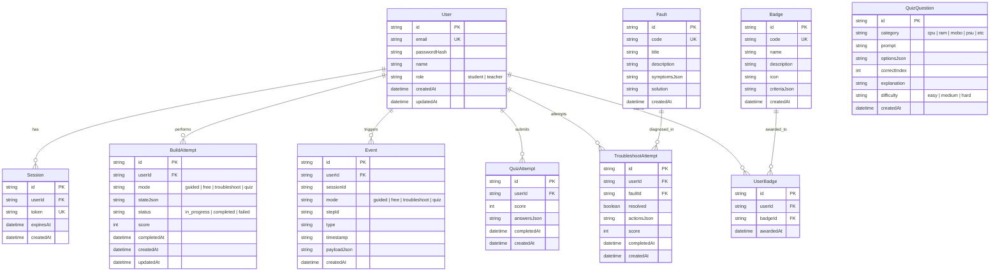

# Virtual Laboratory for Computer Hardware Assembly - Project Plan

A modern web application where students learn and practice PC hardware assembly virtually through interactive 2D simulation, compatibility checks, diagnostic troubleshooting, and role-guarded curricula.

---

## 1. Entity-Relationship (ER) Diagram

---

## 2. API Endpoints Specification

Prefix: `/api/v1`  
All inputs validated with Zod schemas.  
Standard Error Format: `{ "error": { "code": "...", "message": "...", "details": "..." } }`

### Implemented in M0
| Method | Endpoint | Auth | Description |
|---|---|---|---|
| `GET` | `/api/v1/health` | None | Service liveness & uptime check |
| `POST` | `/api/v1/auth/register` | None | Create new student or teacher account |
| `POST` | `/api/v1/auth/login` | None | Authenticate with credentials and receive JWT |
| `GET` | `/api/v1/auth/me` | Bearer JWT | Retrieve profile of authenticated user |
| `POST` | `/api/v1/events` | Optional Bearer JWT | Ingest single or batch telemetry BuildEvents |
| `GET` | `/api-docs` | None | Swagger OpenAPI interactive documentation |

### Planned for Modules M1-M7
| Method | Endpoint | Module | Auth | Description |
|---|---|---|---|---|
| `GET` | `/api/v1/catalog/components` | M1 | None/Student | Fetch available component list from catalog |
| `POST` | `/api/v1/build/validate` | M1 | Student | Validate build state compatibility rules |
| `POST` | `/api/v1/build/boot` | M1 | Student | Simulate BIOS POST & boot sequence |
| `GET` | `/api/v1/builds` | M2 | Student | List user's saved build attempts |
| `POST` | `/api/v1/builds` | M2 | Student | Save / checkpoint active build attempt |
| `GET` | `/api/v1/tutorial/steps` | M4 | Student | Get sequential tutorial instruction steps |
| `GET` | `/api/v1/quizzes` | M5 | Student | Retrieve question bank for quiz mode |
| `POST` | `/api/v1/quizzes/attempt` | M5 | Student | Submit quiz answers and calculate score |
| `GET` | `/api/v1/faults` | M6 | Student | List active troubleshooting scenarios |
| `POST` | `/api/v1/faults/verify` | M6 | Student | Verify if troubleshooting action resolved fault |
| `GET` | `/api/v1/teacher/cohort` | M7 | Teacher | Class roster, completion rates & telemetry stats |
| `GET` | `/api/v1/teacher/analytics/errors` | M7 | Teacher | Heatmap of common student assembly mistakes |

---

## 3. Module Delivery Checklist (M0 - M9)

- [x] **M0: Foundation** (Current)
  - Monorepo structure (`apps/web`, `apps/api`, `packages/shared`, `data/`, `docs/`)
  - `@vlab/shared` contract types, schemas, and `TODO(M1)` stubs
  - Express API with health check, centralized error handler, Zod middleware, Swagger UI
  - Prisma schema with 10 entities, migrations/db push, seed script (1 teacher, 5 students)
  - Authentication (register, login, me, JWT, role guard)
  - React + Vite + Tailwind frontend with AuthContext, ProtectedRoute, and placeholder pages
  - Telemetry event logging (`POST /api/v1/events`)
  - Docker Compose (`db`, `api`, `web`) and `.env.example`
  - Automated tests passing for shared and API
- [ ] **M1: Compatibility & Simulation Engine**
  - Implement full `checkBuild(build, catalog)` rule engine
  - Implement dynamic `simulateBoot(build, catalog)` with POST console & beep codes
  - Power budget calculation & socket/form factor compatibility matrices
- [ ] **M2: Interactive 2D Assembly Workbench Canvas**
  - Drag-and-drop component palette onto chassis and motherboard
  - Visual slot snapping (CPU socket, RAM slots, PCIe slots, storage bays)
  - Component inspection panel with specs and educational "Why It Matters" cards
- [ ] **M3: Detailed Cabling, Screw Mechanics & Thermal Compound**
  - Interactive thermal paste application with coverage visual feedback
  - Pin-to-pin cabling (24-pin ATX, 8-pin EPS 12V, PCIe 8-pin / 12VHPWR, SATA, Front Panel)
  - Standoff placement and screw tightening mechanics
- [ ] **M4: Guided Assembly Tutorial & Progress Tracking**
  - Step-by-step guided mode walking through standard PC build process
  - Real-time step validation and contextual pedagogical hints
  - Free build sandbox mode toggle
- [ ] **M5: Quiz Engine & Gamified Achievement Badges**
  - Category-based quizzes (CPU, RAM, Power, Cooling)
  - Scoring, review explanations, and automated badge awarding (e.g., "First Boot", "Cable Master")
- [ ] **M6: Hardware Diagnostics & Troubleshooting Scenarios**
  - Fault injection mode (unseated RAM, missed EPS cable, standoff short, dry paste)
  - Virtual multimeter and BIOS error code inspection
  - Diagnostic decision tree evaluations
- [ ] **M7: Teacher Analytics Portal & Cohort Tracking**
  - Instructor dashboard displaying student progress and quiz results
  - Aggregated mistake frequency heatmaps across classes
  - CSV export for grades and learning outcome assessment
- [ ] **M8: End-to-End Testing, Audio Feedback & Polish**
  - Playwright end-to-end tests covering login, assembly step, and quiz submission
  - Realistic audio effects (click locks, fan spin, POST beep codes)
  - Accessibility (ARIA labels, keyboard navigation)
- [ ] **M9: Final Deployment, Hardening & Academic Documentation**
  - Production Docker Compose multi-stage build optimization
  - Comprehensive final project documentation and user manual
